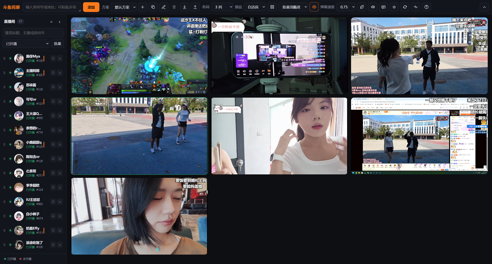

# 斗鱼多房间同屏

在一个页面同时观看多个斗鱼直播间，独立控制每个窗口的声音、弹幕和清晰度。支持本地网页版和 Chrome 扩展，可保存不同的观看方案，适合赛事多视角、多个主播同时观看等场景。

## 功能

- **同屏布局**：自适应或固定 1～5 列，支持焦点布局、窗口放大、拖动标题栏排序、全屏，以及浏览器支持时的画中画。窗口上下工具栏默认隐藏，鼠标移入或操作时出现，停止操作 2 秒后自动收起，让画面更清爽。
- **独立播放控制**：每个房间可调整音量、静音、切换清晰度、重新加载；支持独听、全部静音和批量切换清晰度。
- **弹幕**：接收实时弹幕，支持独立开关、不透明度调整、全局速度调整和一键开关。
- **房间管理**：输入房间号或斗鱼链接，支持批量添加、搜索、状态筛选、拖动排序（含筛选状态下按可见位置插入）和批量打开、关闭、删除；侧栏与播放窗口独立排序，互不影响。
- **聊天窗**：右侧显示所选已打开直播间的实时弹幕，可用工具栏按钮或 `C` 键显示、隐藏。Chrome 扩展版可直接使用当前浏览器登录的斗鱼账号发送弹幕；网页版读不到斗鱼登录状态，只能查看。
  - 顶部显示所选直播间的今日统计（流水、付费人数、贵宾峰值、弹幕人数，悬停看明细）和在线榜、活跃榜（日榜前 10）、贵宾、钻粉四个榜单。今日统计来自第三方站 [dy.roozj.com](https://dy.roozj.com/)，只覆盖该站收录的直播间，流水按礼物价值折算，不是主播实际收入；查询时会把房间号发给该站。榜单与斗鱼网页端一致：选中直播间时以游客身份短暂连接斗鱼网关取一次完整榜单（不使用登录账号），之后由弹幕连接推送更新。
  - 聚会统计：点击聊天窗顶部的聚会图标，把统计区切换为所有已打开直播间的汇总表，按播放窗口顺序列出每个主播的今日流水、贵宾、钻粉人数，多于一间时附合计行。今日流水同样来自 dy.roozj.com；贵宾、钻粉为直播间实时人数，钻粉优先取弹幕榜单，未取到时用该站数据。统计区约每 2.5 分钟刷新一次，所选模式随观看方案保存。
  - 悬浮模式：点击聊天窗顶部的悬浮图标，把聊天窗移到始终置顶的独立小窗，网页右侧不再占位；关闭小窗或再次点击图标即放回原位。依赖浏览器的 Document Picture-in-Picture 接口，需要较新版本的桌面 Chrome 或 Edge。
  - 底部工具栏：弹幕屏蔽与去重、按用户等级屏蔽弹幕（对所有窗口生效），以及当前直播间的弹幕、礼物开关。
- **窗口水印**：视频右下角显示主播昵称，右上角显示实时贵宾数。右上角的统计水印可用工具栏「隐藏 / 显示统计水印」按钮切换，设置随方案保存；弹幕重连时等待更新，尚未获取到数据时显示 `--`。
- **快速打开**：长按 Ctrl，按主播名称搜索斗鱼全站候选，支持方向键、回车或鼠标选择；也可直接输入房间号或链接。
- **礼物浮层**：每窗最多 5 条，按原站观众端消息时长显示（缺失时 5 秒），连击续期；按单价 × 合并数量保护高价值礼物，满额时略过更低价值的新礼物。
- **观看方案**：新建、复制、重命名和切换方案，保存房间列表、已打开窗口、布局及独立设置；支持 JSON 备份与导入。
- **直播状态**：定期检查开播状态，可隐藏未开播窗口，并在检测到开播后自动显示；支持按房间开启开播提醒。
- **延迟对齐**：工具栏「延迟对齐」按钮或 `L` 键开启后，各窗口先跳到缓冲中最新的关键帧，之后本地缓冲积压超过 1.5 秒时以 1.1× 倍速追帧，降到 0.8 秒以下恢复 1×，让多个窗口的画面尽量同步。只能消除浏览器端积压，主播推流和 CDN 本身的延迟差无法对齐。设置随方案保存。
- **H.265 省流**：浏览器能硬件解码 H.265 时，工具栏出现「H.265 省流」按钮。开启后，有 H.265 流的直播间改拉 H.265（同一清晰度通常占用更少带宽），没有的继续用 H.264；某个窗口解码失败会自动改回 H.264。默认关闭，设置随方案保存，诊断中可看到每个窗口的实际编码。
- **自动清晰度**：工具栏「自动清晰度」按钮开启后，焦点、独听、画中画和全屏窗口优先使用最高档，其余窗口按显示尺寸取较低档；某个窗口近期丢帧明显或持续缓冲时逐级降档（丢帧视为整机解码吃力，会先降其他非主窗口；单路缓冲只降它自己），全部稳定约 2 分钟后才逐个回升一档，回升后又吃力会撤回并延长下次等待。自动模式下手动选择的清晰度会锁定该窗口（下拉框选「自动」或批量清晰度选「全部自动」可解除）；录制中的窗口保持当前清晰度不被自动切换。录制中手动换档或切换编码时，录制会在新画面处另起一个文件。默认关闭，设置随方案保存，诊断中可看到每个窗口的自动档位原因。
- **导入斗鱼关注**（仅扩展版）：侧栏「导入关注」读取当前浏览器登录的斗鱼账号的关注列表，勾选后加入当前方案；直播中的排在前面，已在方案中的不能重复勾选。未登录时会提示先打开斗鱼登录。
- **性能与诊断**：低负载模式、播放卡顿检测与自动重试、连接与性能诊断、失败窗口重试。

## 快速开始

### 本地网页版

需要 Node.js **20.9 或更高版本**及 npm，建议使用近期版本的桌面 Chrome 或 Edge。

```bash
git clone https://github.com/tao896/douyu-multiview.git
cd douyu-multiview
npm ci
npm start
```

打开 [http://127.0.0.1:8787](http://127.0.0.1:8787)，输入房间号或直播间地址即可添加。

开发时可使用文件变更后自动重启服务的模式：

```bash
npm run dev
```

服务默认监听 `127.0.0.1:8787`，可通过环境变量修改。以下命令适用于 macOS / Linux：

```bash
# 更换端口
PORT=8888 npm start

# 允许局域网设备访问
HOST=0.0.0.0 PORT=8787 npm start
```

PowerShell 可使用 `$env:PORT = '8888'; npm start` 设置端口。

局域网设备需访问运行服务的电脑的局域网 IP。服务没有账号鉴权，默认仅供本机使用；不要直接暴露到公网。网页版需要通过服务访问，不能直接双击 `public/index.html` 运行。

### Chrome 扩展

扩展安装后无需运行本地 Node.js 服务。

仓库中的 `chrome-extension/` 是已打包的扩展目录，可以直接加载。修改 `public/`、`extension/` 或播放器依赖后，在安装依赖后执行：

```bash
npm run build:extension
```

1. 打开 Chrome 扩展管理页 `chrome://extensions/`。
2. 开启右上角的「开发者模式」。
3. 点击「加载已解压的扩展程序」。
4. 选择仓库中的 `chrome-extension/`。
5. 点击浏览器工具栏中的「斗鱼多房间同屏」扩展图标，打开观看页面。

构建会清空并重新生成 `chrome-extension/`（`public/` 加上 `extension/` 中的覆盖文件和 `vendor/mpegts.js`），因此不要手工修改该目录。重新构建后在扩展管理页点击重新加载，再刷新观看页面。`npm test` 会检查 `chrome-extension/` 是否与源码一致，忘记构建时会失败。`extension/` 仅包含扩展专用源码，不能单独作为完整扩展加载。如需输出到其他目录，可执行 `node build-extension.js <目录>`。

扩展使用 Manifest V3，需要斗鱼相关域名和「在看直播」的访问权限，以及用于开播提醒的通知权限。

## 使用说明

### 添加与管理房间

在顶部输入房间号（如 `9999`）或直播间地址（如 `https://www.douyu.com/9999`），也可以一次粘贴多个房间。批量添加会显示新增、重复及失败结果。

侧栏默认筛选「已开播」，查找离线房间时可切换为「全部」或「未开播」。关闭播放窗口会保留侧栏中的房间；从侧栏删除则会从当前方案移除该房间。

点击窗口中的「独听」可只保留该房间的声音，退出后恢复此前各窗口的静音状态。多窗口播放占用较高时，可降低清晰度、关闭部分弹幕或启用低负载模式。

低负载模式会在页面处于后台或窗口不可见约 30 秒后暂停符合条件的静音窗口；正在发声、独听或画中画中的窗口会继续播放。

### 配置与备份

观看方案保存在当前浏览器来源的 `localStorage` 中，刷新页面后会恢复。项目不提供云同步；不同浏览器、网页版与扩展版，以及不同地址或端口之间的配置不会自动共享。

使用顶部「备份」按钮导出全部观看方案为 JSON 文件。「导入」支持合并为新方案，或替换全部配置；替换前会自动下载现有配置备份。清理浏览器数据或迁移环境前，建议先导出备份。

### 开播提醒

点击侧栏房间旁的铃铛开启提醒。提醒由当前观看方案的状态检查触发，需要保持观看页面打开，关闭页面后不会继续监测。

页面在前台时显示页内提示，在后台时尝试发送系统通知；网页版需要授予浏览器通知权限。只有检测到房间从未开播变为已开播才会提醒，同一次开播不重复通知。浏览器后台限流或系统休眠可能延迟提醒。

### 快捷键

| 按键 | 操作 |
| --- | --- |
| 长按 `Ctrl` | 按住约 0.3 秒打开快速打开框，按主播名称搜索或输入房间号、链接；框已打开时再次长按则关闭 |
| `A` | 聚焦添加房间输入框 |
| `/` | 聚焦房间搜索 |
| `B` | 展开或收起侧栏 |
| `T` | 隐藏或显示顶部工具栏 |
| `C` | 显示或隐藏聊天窗 |
| `M` | 全部静音或取消静音 |
| `D` | 弹幕全开或全关 |
| `R` | 刷新所有窗口 |
| `L` | 延迟对齐开或关 |
| `1`～`9` | 独听对应窗口 |
| `?` | 显示快捷键帮助 |
| `Esc` | 关闭面板或清除搜索，也可关闭快速打开框 |

输入框或下拉框获得焦点时，不触发字母、数字快捷键及长按 `Ctrl`；有对话框打开时也不响应长按 `Ctrl`。快速打开框中可用 `↑` / `↓` 选择候选、`Enter` 打开，点击框外也会关闭。

## 开发与测试

前端使用原生 JavaScript、HTML 和 CSS，通过 `mpegts.js` 播放 FLV 直播，使用 WebSocket 接收弹幕、Canvas 绘制弹幕。

网页版由 Node.js 提供静态文件及房间信息、直播流签名接口；视频和弹幕由浏览器直接连接上游。扩展版通过 Service Worker 处理房间信息和取流请求，共用 `public/` 中的界面与交互代码。

| 路径 | 用途 |
| --- | --- |
| `public/` | 共享前端、播放器、弹幕、状态管理和界面；`app.js` 负责组装，侧栏、对话框、快捷键、诊断、备份、开播提醒、导入关注等拆在同目录的独立模块中 |
| `server.js` | 本地 HTTP 服务与 API 路由 |
| `public/douyu-client.js` | 房间解析、信息获取与取流签名，网页版与扩展版共用 |
| `lib/douyu.js` | Node.js 端适配：为上游请求加上 UA 和 Referer |
| `extension/` | 扩展清单、后台脚本、关注列表及浏览器端适配 |
| `build-extension.js` | 合并前端、扩展源码及播放器依赖，生成 `chrome-extension/` |
| `chrome-extension/` | 构建产物，可直接加载；不要手工修改 |
| `test/` | Node.js 单元测试（`node --test`） |
| `e2e/` | Playwright 端到端测试 |

```bash
# 单元测试
npm test

# 首次运行浏览器测试前安装 Chromium
npx playwright install chromium

# 浏览器端到端测试
npm run test:e2e

# 单元测试与端到端测试
npm run test:all
```

端到端测试会启动或复用 `127.0.0.1:8791` 上的服务，使用模拟 API 和播放器验证界面流程，不代表真实直播源可用。实际播放、声音、多路音画同步和通知仍需在浏览器中打开真实直播间手工验收。

## 常见问题

- **没有声音或提示点击播放**：浏览器可能限制自动播放；手动点击播放，并检查窗口音量、静音和独听状态。
- **播放失败或长时间卡住**：先确认房间已开播，再尝试重新加载或切换清晰度；「连接与性能诊断」可查看状态并重试失败窗口。上游接口、直播源或网络变化也可能导致失败。
- **找不到已添加的房间**：检查侧栏搜索条件和状态筛选，默认「已开播」会过滤离线房间；画面区还可单独开启「隐藏未开播窗口」。
- **没有开播通知**：确认当前方案中的铃铛已开启、观看页面仍打开，并检查浏览器与系统通知权限；前台页面只显示页内提示。
- **手机或其他浏览器不能播放**：界面支持窄屏布局，但实际播放依赖浏览器的媒体能力及直播编码，建议优先使用桌面 Chrome 或 Edge。

- **聊天窗没有悬浮图标或悬浮失败**：悬浮模式依赖 Document Picture-in-Picture，Firefox、Safari 及旧版 Chrome / Edge 不支持，此时按钮不起作用；请改用右侧停靠的聊天窗。

本项目为第三方工具，非斗鱼官方产品；直播内容和服务由相关平台提供，接口变化可能影响功能可用性。
